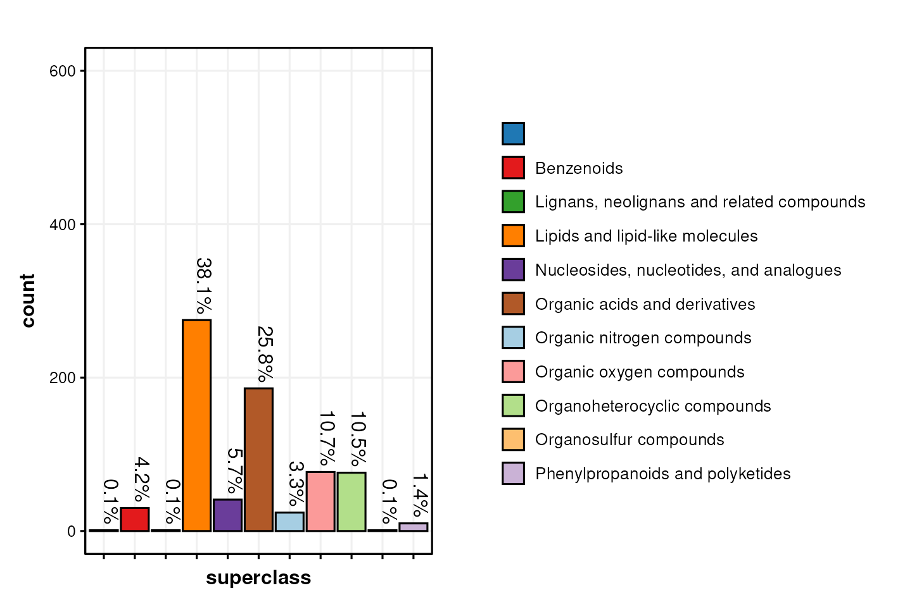
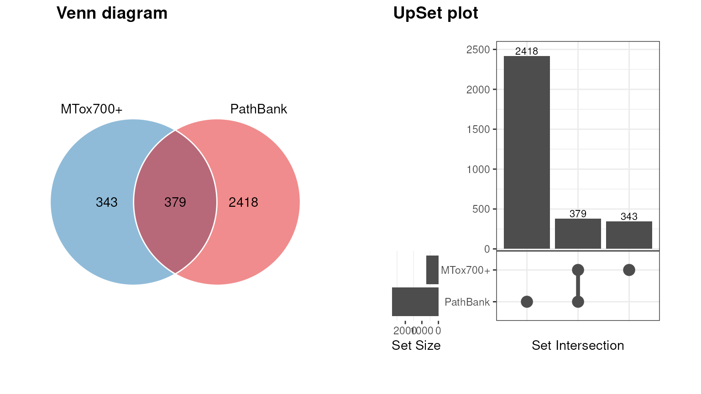
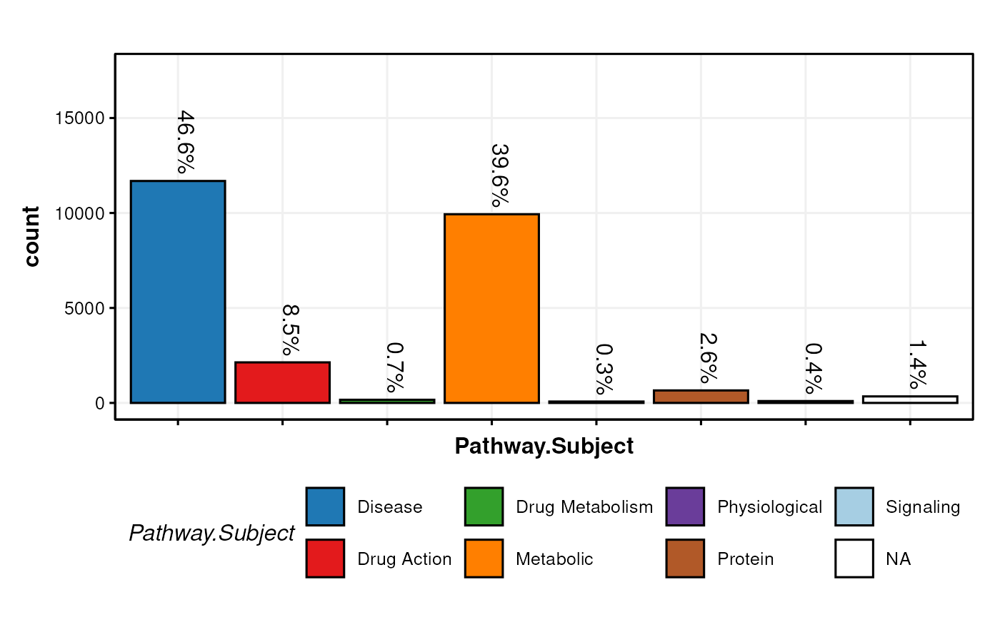

# Exploring chemical classes and pathway coverage in MTox700+

**Note:** This vignette is built without network access. Online
databases are read from stored copies included with `MetMashR`, and REST
API lookups use stored response caches with `cache_mode = "offline"`, so
a value that is not in a cache is left as `NA` instead of being queried.
To query the online services yourself, use your own cache and the
default `cache_mode = "update"`. The stored copies were made with
`inst/scripts/make_vignette_snapshots.R`.

\

\# Getting Started The latest versions of
*[struct](https://bioconductor.org/packages/3.24/struct)* and `MetMashR`
that are compatible with your current R version can be installed using
BiocManager.

\
`# install BiocManager if not present`\
`if`` ``(``!`[`requireNamespace`](https://rdrr.io/r/base/ns-load.html)`(``"BiocManager"``, quietly ``=`` ``TRUE``)``)`` ``{`\
`    `[`install.packages`](https://rdrr.io/r/utils/install.packages.html)`(``"BiocManager"``)`\
`}`\
\
`# install MetMashR and dependencies`\
`BiocManager``::`[`install`](https://bioconductor.github.io/BiocManager/reference/install.html)`(``"MetMashR"``)`

Once installed you can activate the packages in the usual way:

\
`# load the packages`\
[`library`](https://rdrr.io/r/base/library.html)`(`[`MetMashR`](https://computational-metabolomics.github.io/MetMashR/)`)`\
[`library`](https://rdrr.io/r/base/library.html)`(`[`ggplot2`](https://ggplot2.tidyverse.org)`)`\
[`library`](https://rdrr.io/r/base/library.html)`(`[`structToolbox`](https://github.com/computational-metabolomics/structToolbox)`)`\
[`library`](https://rdrr.io/r/base/library.html)`(`[`dplyr`](https://dplyr.tidyverse.org)`)`\
[`library`](https://rdrr.io/r/base/library.html)`(`[`DT`](https://github.com/rstudio/DT)`)`\
[`library`](https://rdrr.io/r/base/library.html)`(`[`ggplotify`](https://github.com/GuangchuangYu/ggplotify)`)`

\

## Introduction

> MTox700+ is a list of toxicologically relevant metabolites derived
> from publications, public databases and relevant toxicological assays.

In this vignette you will learn how to combine MTox700+ with the
PathBank pathway database to see which chemical classes MTox700+
contains and how many of its metabolites have pathway information in
PathBank.

\

## Importing the MTox700+ database

The MTox700+ database can be imported using the `MTox700plus_database`
object, which downloads a release of the database from GitHub. In this
vignette we read a stored copy of the database with
[`rds_database()`](https://computational-metabolomics.github.io/MetMashR/reference/rds_database.md).
A table describing the stored copies included with `MetMashR` records
which release was stored and when it was downloaded.

\
`# where and when the stored copies were retrieved`\
`snapshots`` ``<-`` `[`readRDS`](https://rdrr.io/r/base/readRDS.html)`(`[`system.file`](https://rdrr.io/r/base/system.file.html)`(`\
`    ``"extdata/vignette_snapshots/snapshot_info.rds"``,`\
`    package ``=`` ``"MetMashR"`\
`)``)`\
`snapshots``[`\
`    ``snapshots``$``resource`` `[`%in%`](https://rdrr.io/r/base/match.html)` `[`c`](https://rdrr.io/r/base/c.html)`(``"MTox700+"``, ``"PathBank"``)``,`\
`    `[`c`](https://rdrr.io/r/base/c.html)`(``"resource"``, ``"version"``, ``"retrieved"``)`\
`]`\
`#>                                  resource version  retrieved`\
`#> MTox700plus.rds                  MTox700+    v1.0 2024-01-25`\
`#> PathBank_primary_metabolites.rds PathBank primary 2023-11-23`\
\
`# prep object (stored copy of MTox700+)`\
`MT`` ``<-`` `[`rds_database`](https://computational-metabolomics.github.io/MetMashR/reference/rds_database.md)`(`\
`    source ``=`` `[`system.file`](https://rdrr.io/r/base/system.file.html)`(`\
`        ``"extdata/vignette_snapshots/MTox700plus.rds"``,`\
`        package ``=`` ``"MetMashR"`\
`    ``)``,`\
`    tag ``=`` ``"MTox700+"``,`\
`    .writable ``=`` ``FALSE`\
`)`\
\
`# import`\
`df`` ``<-`` `[`read_database`](https://computational-metabolomics.github.io/MetMashR/reference/read_database.md)`(``MT``)`\
\
`# show contents`\
`.DT``(``df``)`

This example uses MTox700+ release v1.0, downloaded on 2024-01-25.

\
`# prepare workflow that uses MTox700+ as a source`\
`M`` ``<-`\
`    `[`import_source`](https://computational-metabolomics.github.io/MetMashR/reference/import_source.md)`(``)`` ``+`\
`    `[`trim_whitespace`](https://computational-metabolomics.github.io/MetMashR/reference/trim_whitespace.md)`(`\
`        column_name ``=`` ``".all"``,`\
`        which ``=`` ``"both"``,`\
`        whitespace ``=`` ``"[\\h\\v]"`\
`    ``)`\
\
`# apply`\
`M`` ``<-`` `[`model_apply`](https://computational-metabolomics.github.io/MetMashR/reference/model_apply.md)`(``M``, ``MT``)`

\

## Exploring the chemical space

The chemical (or “metabolite”) space covered by the MTox700+ database
can be explored in several ways using the data included in the database,
which contains information about the structural classification of the
metabolites based on ChemOnt (a chemical taxonomy) and ClassyFire
(software to compute the taxonomy of a structure)
\[10.1186/s13321-016-0174-y\].

In this plot we show the number of metabolites in the MTox700+ database
that are assigned to a “superclass” of molecules.

\
`# initialise chart object`\
`C`` ``<-`` `[`annotation_bar_chart`](https://computational-metabolomics.github.io/MetMashR/reference/annotation_bar_chart.md)`(`\
`    factor_name ``=`` ``"superclass"``,`\
`    label_rotation ``=`` ``TRUE``,`\
`    label_location ``=`` ``"outside"``,`\
`    label_type ``=`` ``"percent"``,`\
`    legend ``=`` ``TRUE`\
`)`\
\
`# plot`\
`g`` ``<-`` `\
`    `[`chart_plot`](https://computational-metabolomics.github.io/MetMashR/reference/chart_plot.md)`(``C``, `[`predicted`](https://rdrr.io/pkg/struct/man/predicted.html)`(``M``)``)`` ``+`` `\
`    `[`ylim`](https://ggplot2.tidyverse.org/reference/lims.html)`(`[`c`](https://rdrr.io/r/base/c.html)`(``0``, ``600``)``)`` ``+`\
`    `[`guides`](https://ggplot2.tidyverse.org/reference/guides.html)`(`\
`        fill ``=`` `[`guide_legend`](https://ggplot2.tidyverse.org/reference/guide_legend.html)`(``ncol ``=`` ``1``, title ``=`` ``NULL``)``,byrow``=``TRUE``)`` ``+`\
`    `[`theme`](https://ggplot2.tidyverse.org/reference/theme.html)`(`\
`        legend.position ``=`` ``"right"``, `\
`        legend.margin ``=`` `[`margin`](https://ggplot2.tidyverse.org/reference/element.html)`(``)``,`\
`        legend.key.size ``=`` `[`unit`](https://rdrr.io/r/grid/unit.html)`(``0.5``, ``"cm"``)``,   `\
`        legend.text ``=`` `[`element_text`](https://ggplot2.tidyverse.org/reference/element.html)`(``size ``=`` ``10``)`\
`    ``)`\
\
`# layout`\
`leg`` ``<-`` ``cowplot``::`[`get_legend`](https://wilkelab.org/cowplot/reference/get_legend.html)`(``g``)`\
`cowplot``::`[`plot_grid`](https://wilkelab.org/cowplot/reference/plot_grid.html)`(``g`` ``+`` `[`theme`](https://ggplot2.tidyverse.org/reference/theme.html)`(``legend.position ``=`` ``"none"``)``, ``leg``,`\
`    nrow ``=`` ``1``,`\
`    rel_widths ``=`` `[`c`](https://rdrr.io/r/base/c.html)`(``50``, ``50``)`\
`)`

\

## Exploring the biological space

To explore the biological space covered by the metabolites in MTox700+
we need mash the database with additional information about the
biological pathways that the metabolites are part of.

We use [PathBank](https://pathbank.org/) for this purpose. `MetMashR`
already includes a database source for PathBank.

\

### Importing PathBank

`MetMashR` provides the
[`PathBank_metabolite_database()`](https://computational-metabolomics.github.io/MetMashR/reference/PathBank_metabolite_database.md)
object to import the PathBank database. You can choose to import:

- The “primary” database. This is a smaller version of the database
  restricted to primary pathways.
- The “complete” database, which includes all pathways in the database.

The “complete” database is a \>50mb download, and unzipped is \>1Gb.
Unzipping and caching of the database is handled by \[BiocFileCache\].

For the vignette we use a stored copy of the “primary” PathBank
database, keeping only the columns used below.

We can use the database in two ways:

1.  convert it to a source and “mash” it with other sources
2.  use it as a lookup table to add information to an existing source.

To explore the biological space covered by MetMashR we will do both.

\

### Comparing PathBank and MTox700+

It is useful to visualise the overlap between PathBank and MTox700+.
MTox700+ is a much smaller database due to it being a curated list of
metabolites with toxicologial relevance, and PathBank is more general.

In th example below we import PathBank as a source, and use a venn
diagram to compare the overlap between inchikey identifiers in PathBank
and MTox700+.

\
`# object M already contains the MTox700+ database as a source`\
\
`# prepare PathBank as a source (stored copy of the primary database)`\
`P`` ``<-`` `[`rds_database`](https://computational-metabolomics.github.io/MetMashR/reference/rds_database.md)`(`\
`    source ``=`` `[`system.file`](https://rdrr.io/r/base/system.file.html)`(`\
`        ``"extdata/vignette_snapshots/PathBank_primary_metabolites.rds"``,`\
`        package ``=`` ``"MetMashR"`\
`    ``)``,`\
`    tag ``=`` ``"PathBank"``,`\
`    .writable ``=`` ``FALSE`\
`)`\
\
`# import`\
`P`` ``<-`` `[`read_source`](https://computational-metabolomics.github.io/MetMashR/reference/read_source.md)`(``P``)`\
\
`# prepare chart`\
`C`` ``<-`` `[`annotation_venn_chart`](https://computational-metabolomics.github.io/MetMashR/reference/annotation_venn_chart.md)`(`\
`    factor_name ``=`` `[`c`](https://rdrr.io/r/base/c.html)`(``"inchikey"``, ``"InChI.Key"``)``, legend ``=`` ``FALSE``,`\
`    fill_colour ``=`` ``".group"``,`\
`    line_colour ``=`` ``"white"`\
`)`\
\
`# plot`\
`g1`` ``<-`` `[`chart_plot`](https://computational-metabolomics.github.io/MetMashR/reference/chart_plot.md)`(``C``, `[`predicted`](https://rdrr.io/pkg/struct/man/predicted.html)`(``M``)``, ``P``)`\
\
`C`` ``<-`` `[`annotation_upset_chart`](https://computational-metabolomics.github.io/MetMashR/reference/annotation_upset_chart.md)`(`\
`    factor_name ``=`` `[`c`](https://rdrr.io/r/base/c.html)`(``"inchikey"``, ``"InChI.Key"``)``,`\
`)`\
`g2`` ``<-`` `[`as.ggplot`](https://rdrr.io/pkg/ggplotify/man/as.ggplot.html)`(`[`chart_plot`](https://computational-metabolomics.github.io/MetMashR/reference/chart_plot.md)`(``C``, `[`predicted`](https://rdrr.io/pkg/struct/man/predicted.html)`(``M``)``, ``P``)``)`` ``+`\
`  `[`theme`](https://ggplot2.tidyverse.org/reference/theme.html)`(``plot.margin ``=`` `[`unit`](https://rdrr.io/r/grid/unit.html)`(`[`c`](https://rdrr.io/r/base/c.html)`(``1``, ``1``, ``1``, ``1``)``, ``"cm"``)``)`\
`cowplot``::`[`plot_grid`](https://wilkelab.org/cowplot/reference/plot_grid.html)`(``g1``, ``g2``, nrow ``=`` ``1``, labels ``=`` `[`c`](https://rdrr.io/r/base/c.html)`(``"Venn diagram"``, ``"UpSet plot"``)``)`

PathBank does not report a version number, so we report the date the
stored copy was downloaded: 2023-11-23.

These charts compare full InChIKeys in MTox700+ with those in the
selected PathBank primary-pathway dataset. To report the overlap, we
count the distinct, non-missing keys shared by both resources and divide
by the number of distinct, non-missing MTox700+ keys.

\
`# distinct, non-missing InChIKeys`\
`keys`` ``<-`` ``function``(``x``)`` ``{`\
`    ``x`` ``<-`` `[`unique`](https://rdrr.io/r/base/unique.html)`(``x``)`\
`    ``x``[``!`[`is.na`](https://rdrr.io/r/base/NA.html)`(``x``)`` ``&`` ``x`` ``!=`` ``""``]`\
`}`\
`mtox_keys`` ``<-`` ``keys``(`[`predicted`](https://rdrr.io/pkg/struct/man/predicted.html)`(``M``)``$``data``$``inchikey``)`\
`pathbank_keys`` ``<-`` ``keys``(``P``$``data``$``InChI.Key``)`\
`shared_keys`` ``<-`` `[`intersect`](https://generics.r-lib.org/reference/setops.html)`(``mtox_keys``, ``pathbank_keys``)`\
\
`# MTox700+ records with no InChIKey`\
`n_missing`` ``<-`` `[`sum`](https://rdrr.io/r/base/sum.html)`(`[`is.na`](https://rdrr.io/r/base/NA.html)`(`[`predicted`](https://rdrr.io/pkg/struct/man/predicted.html)`(``M``)``$``data``$``inchikey``)`` ``|`\
`    `[`predicted`](https://rdrr.io/pkg/struct/man/predicted.html)`(``M``)``$``data``$``inchikey`` ``==`` ``""``)`\
\
[`data.frame`](https://rdrr.io/r/base/data.frame.html)`(`\
`    mtox_keys ``=`` `[`length`](https://rdrr.io/r/base/length.html)`(``mtox_keys``)``,`\
`    shared_keys ``=`` `[`length`](https://rdrr.io/r/base/length.html)`(``shared_keys``)``,`\
`    percent_shared ``=`` `[`round`](https://rdrr.io/r/base/Round.html)`(``100`` ``*`` `[`length`](https://rdrr.io/r/base/length.html)`(``shared_keys``)`` ``/`` `[`length`](https://rdrr.io/r/base/length.html)`(``mtox_keys``)``, ``1``)``,`\
`    mtox_records_without_key ``=`` ``n_missing`\
`)`\
`#>   mtox_keys shared_keys percent_shared mtox_records_without_key`\
`#> 1       722         379           52.5                        0`

Of the 722 distinct MTox700+ InChIKeys, 379 (52.5%) are also in the
PathBank primary-pathway dataset; 0 MTox700+ records have no InChIKey.
An unmatched key means that it was not found in this PathBank subset; it
does not show that the metabolite has no known pathway associations.

\

### Combining MTox700+ with PathBank

To combine the pathway information in PathBank with the MTox700+
database we can use PathBank as a lookup table based on inchikeys. To do
this we use the `database_lookup` object.

We request a number of columns from PathBank, including pathway
information and additional identifiers such as HMDB ID and KEGG ID.

\
`# prepare object`\
`X`` ``<-`` `[`database_lookup`](https://computational-metabolomics.github.io/MetMashR/reference/database_lookup.md)`(`\
`    query_column ``=`` ``"inchikey"``,`\
`    database ``=`` ``P``$``data``,`\
`    database_column ``=`` ``"InChI.Key"``,`\
`    include ``=`` `[`c`](https://rdrr.io/r/base/c.html)`(`\
`        ``"PathBank.ID"``, ``"Pathway.Name"``, ``"Pathway.Subject"``, ``"Species"``,`\
`        ``"HMDB.ID"``, ``"KEGG.ID"``, ``"ChEBI.ID"``, ``"DrugBank.ID"``, ``"SMILES"`\
`    ``)``,`\
`    suffix ``=`` ``""`\
`)`\
\
`# apply`\
`X`` ``<-`` `[`model_apply`](https://computational-metabolomics.github.io/MetMashR/reference/model_apply.md)`(``X``, `[`predicted`](https://rdrr.io/pkg/struct/man/predicted.html)`(``M``)``)`

We can now visualise e.g. the subject of the pathways captured by the
MTox700+ database. This chart counts records after the PathBank join.
One metabolite can contribute more than once if it matches several
pathways.

\
`C`` ``<-`` `[`annotation_bar_chart`](https://computational-metabolomics.github.io/MetMashR/reference/annotation_bar_chart.md)`(`\
`    factor_name ``=`` ``"Pathway.Subject"``,`\
`    label_rotation ``=`` ``TRUE``,`\
`    label_location ``=`` ``"outside"``,`\
`    label_type ``=`` ``"percent"``,`\
`    legend ``=`` ``TRUE`\
`)`\
\
[`chart_plot`](https://computational-metabolomics.github.io/MetMashR/reference/chart_plot.md)`(``C``, `[`predicted`](https://rdrr.io/pkg/struct/man/predicted.html)`(``X``)``)`` ``+`` `[`ylim`](https://ggplot2.tidyverse.org/reference/lims.html)`(`[`c`](https://rdrr.io/r/base/c.html)`(``0``, ``17500``)``)`

The percentages describe these joined records, including any unmatched
records retained by the lookup. This example includes all returned
species, so the chart alone does not establish coverage of human
toxicology.

\

### Combining records

Metabolites can appear in multiple pathways. The PathBank database
therefore contains multiple records for the same metabolite, and the
relationship between MTox700+ and PathBank is one-to-many.

After obtaining pathway information from PathBank the new table has many
more rows than the original MTox700+ database, as each MTox700+ record
has been replicated for each match in the PathBank database.

e.g. after importing MTox700+ the number of records was:

\
`# Number in MTox700+`\
[`nrow`](https://rdrr.io/r/base/nrow.html)`(`[`predicted`](https://rdrr.io/pkg/struct/man/predicted.html)`(``M``)``$``data``)`\
`#> [1] 722`

After combing with PathBank the number of records is:

\
`# Number after PathBank lookup`\
[`nrow`](https://rdrr.io/r/base/nrow.html)`(`[`predicted`](https://rdrr.io/pkg/struct/man/predicted.html)`(``X``)``$``data``)`\
`#> [1] 25092`

Sometimes it is useful to collapse this information into a single record
per metabolite. We can use the `combine_records` object and its helper
functions to do this in a `MetMashR` workflow. Before collapsing the
records we save the full table of matches, which has one row per
metabolite and pathway.

\
`# save the full table of matches before collapsing`\
`pathway_matches`` ``<-`` `[`predicted`](https://rdrr.io/pkg/struct/man/predicted.html)`(``X``)``$``data`\
\
`# prepare object`\
`X`` ``<-`` `[`database_lookup`](https://computational-metabolomics.github.io/MetMashR/reference/database_lookup.md)`(`\
`    query_column ``=`` ``"inchikey"``,`\
`    database ``=`` ``P``$``data``,`\
`    database_column ``=`` ``"InChI.Key"``,`\
`    include ``=`` `[`c`](https://rdrr.io/r/base/c.html)`(`\
`        ``"PathBank.ID"``, ``"Pathway.Name"``, ``"Pathway.Subject"``, ``"Species"``,`\
`        ``"HMDB.ID"``, ``"KEGG.ID"``, ``"ChEBI.ID"``, ``"DrugBank.ID"``, ``"SMILES"`\
`    ``)``,`\
`    suffix ``=`` ``""`\
`)`` ``+`\
`    `[`combine_records`](https://computational-metabolomics.github.io/MetMashR/reference/combine_records.md)`(`\
`        group_by ``=`` ``"inchikey"``,`\
`        default_fcn ``=`` `[`fuse_unique`](https://computational-metabolomics.github.io/MetMashR/reference/combine_records_helper_functions.md)`(``" || "``)`\
`    ``)`\
\
`# apply`\
`X`` ``<-`` `[`model_apply`](https://computational-metabolomics.github.io/MetMashR/reference/model_apply.md)`(``X``, `[`predicted`](https://rdrr.io/pkg/struct/man/predicted.html)`(``M``)``)`

We have used the
[`fuse_unique()`](https://computational-metabolomics.github.io/MetMashR/reference/combine_records_helper_functions.md)
helper function so that records for each inchikey are combined into a
single record by only retaining unique values in each field (column). If
there are multiple unique values for a field then they are combined into
a single string using the ” \|\| ” separator.

We can now extract the pathways associated with a particular metabolite.
For example Glycolic acid:

\
`# get index of metabolite`\
`w`` ``<-`` `[`which`](https://rdrr.io/r/base/which.html)`(`[`predicted`](https://rdrr.io/pkg/struct/man/predicted.html)`(``X``)``$``data``$``metabolite_name`` ``==`` ``"Glycolic acid"``)`

The pathways associated with Glycolic acid are:

\
`# print list of pathways`\
[`predicted`](https://rdrr.io/pkg/struct/man/predicted.html)`(``X``)``$``data``$``Pathway.Name``[``w``]`\
`#> [1] "Inner Membrane Transport || Glycolate and Glyoxylate Degradation || D-Arabinose Degradation I || Ethylene Glycol Degradation"`

The summary lists unique values from each column separately. Values in
the same position in those lists may not come from the same original
row. Use the saved full table to see which pathway ID, pathway name and
species belong together:

\
`glycolic`` ``<-`` ``pathway_matches``[`\
`    ``pathway_matches``$``metabolite_name`` ``==`` ``"Glycolic acid"``,`\
`    `[`c`](https://rdrr.io/r/base/c.html)`(``"PathBank.ID"``, ``"Pathway.Name"``, ``"Species"``)`\
`]`\
`.DT``(``glycolic``)`

\

## Summary

Combining MTox700+ with PathBank shows which MTox700+ metabolites have
pathway information in the PathBank primary-pathway dataset, and which
pathway subjects those matches belong to. The comparison has limits.
Matching uses full InChIKeys, so a metabolite recorded in a different
form (e.g. a different charge state or stereoisomer) is not matched.
Only the primary-pathway subset of PathBank is used, and all species are
included. The pathway charts count joined records rather than
metabolites, so metabolites in many pathways have more weight.

\

## Session info

\
[`sessionInfo`](https://rdrr.io/r/utils/sessionInfo.html)`(``)`\
`#> R version 4.6.1 (2026-06-24)`\
`#> Platform: x86_64-pc-linux-gnu`\
`#> Running under: Ubuntu 24.04.5 LTS`\
`#> `\
`#> Matrix products: default`\
`#> BLAS:   /usr/lib/x86_64-linux-gnu/openblas-pthread/libblas.so.3 `\
`#> LAPACK: /usr/lib/x86_64-linux-gnu/openblas-pthread/libopenblasp-r0.3.26.so;  LAPACK version 3.12.0`\
`#> `\
`#> locale:`\
`#>  [1] LC_CTYPE=en_US.UTF-8       LC_NUMERIC=C              `\
`#>  [3] LC_TIME=en_US.UTF-8        LC_COLLATE=en_US.UTF-8    `\
`#>  [5] LC_MONETARY=en_US.UTF-8    LC_MESSAGES=en_US.UTF-8   `\
`#>  [7] LC_PAPER=en_US.UTF-8       LC_NAME=C                 `\
`#>  [9] LC_ADDRESS=C               LC_TELEPHONE=C            `\
`#> [11] LC_MEASUREMENT=en_US.UTF-8 LC_IDENTIFICATION=C       `\
`#> `\
`#> time zone: UTC`\
`#> tzcode source: system (glibc)`\
`#> `\
`#> attached base packages:`\
`#> [1] stats     graphics  grDevices utils     datasets  methods   base     `\
`#> `\
`#> other attached packages:`\
`#> [1] ggplotify_0.1.4      DT_0.34.0            dplyr_1.2.1         `\
`#> [4] structToolbox_1.25.0 ggplot2_4.0.3        MetMashR_1.7.3      `\
`#> [7] struct_1.25.0        BiocStyle_2.41.0    `\
`#> `\
`#> loaded via a namespace (and not attached):`\
`#>  [1] SummarizedExperiment_1.43.0 gtable_0.3.6               `\
`#>  [3] xfun_0.62                   bslib_0.12.0               `\
`#>  [5] httr2_1.3.0                 htmlwidgets_1.6.4          `\
`#>  [7] Biobase_2.73.2              lattice_0.23-1             `\
`#>  [9] crosstalk_1.2.2             yulab.utils_0.2.5          `\
`#> [11] vctrs_0.7.3                 tools_4.6.1                `\
`#> [13] generics_0.1.4              stats4_4.6.1               `\
`#> [15] tibble_3.3.1                pkgconfig_2.0.3            `\
`#> [17] Matrix_1.7-6                RColorBrewer_1.1-3         `\
`#> [19] S7_0.2.2                    desc_1.4.3                 `\
`#> [21] S4Vectors_0.51.10           lifecycle_1.0.5            `\
`#> [23] compiler_4.6.1              farver_2.1.2               `\
`#> [25] textshaping_1.0.5           Seqinfo_1.3.2              `\
`#> [27] ggfun_0.2.2                 htmltools_0.5.9            `\
`#> [29] sass_0.4.10                 yaml_2.3.12                `\
`#> [31] tidyr_1.3.2                 pkgdown_2.2.1.9000         `\
`#> [33] pillar_1.11.1               jquerylib_0.1.4            `\
`#> [35] DelayedArray_0.39.8         cachem_1.1.0               `\
`#> [37] abind_1.4-8                 aplot_0.3.2                `\
`#> [39] tidyselect_1.2.1            digest_0.6.39              `\
`#> [41] purrr_1.2.2                 bookdown_0.48              `\
`#> [43] forcats_1.0.1               labeling_0.4.3             `\
`#> [45] ggthemes_7.0.0              cowplot_1.2.0              `\
`#> [47] fastmap_1.2.0               grid_4.6.1                 `\
`#> [49] cli_3.6.6                   SparseArray_1.13.4         `\
`#> [51] magrittr_2.0.5              patchwork_1.3.2            `\
`#> [53] S4Arrays_1.13.2             withr_3.0.3                `\
`#> [55] rappdirs_0.3.4              scales_1.4.0               `\
`#> [57] sp_2.2-4                    rmarkdown_2.32             `\
`#> [59] XVector_0.53.0              httr_1.4.9                 `\
`#> [61] matrixStats_1.5.0           otel_0.2.0                 `\
`#> [63] gridExtra_2.3.1             ragg_1.5.2                 `\
`#> [65] evaluate_1.0.5              knitr_1.52                 `\
`#> [67] GenomicRanges_1.65.4        IRanges_2.47.5             `\
`#> [69] gridGraphics_0.5-1          rlang_1.3.0                `\
`#> [71] Rcpp_1.1.2                  ggVennDiagram_1.5.7        `\
`#> [73] glue_1.8.1                  BiocManager_1.30.27        `\
`#> [75] xml2_1.6.0                  BiocGenerics_0.59.12       `\
`#> [77] jsonlite_2.0.0              R6_2.6.1                   `\
`#> [79] plyr_1.8.9                  MatrixGenerics_1.25.0      `\
`#> [81] systemfonts_1.3.2           fs_2.1.0`
